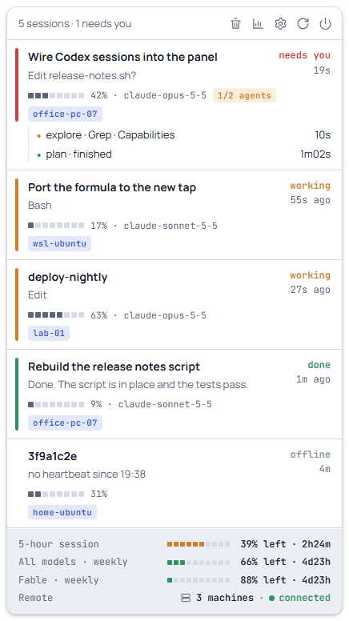

# cc-usage

A Windows 11 tray widget for Claude Code. It lists every Claude Code session
on this machine (what it is doing, whether it needs you, its subagents and
context use) and the plan usage (the 5-hour and weekly limits, per-model
sub-limits, activity and per-project cost), without a browser. Sessions on
other Windows and Linux machines appear too, through an end-to-end encrypted
NATS feed.

Unofficial: not affiliated with or endorsed by Anthropic. The plan usage
comes from an undocumented endpoint that Claude Code itself uses, read with
Claude Code's own login, so it can change or stop working without notice.



## Install

Requires Windows 11 and Claude Code installed and logged in on this
machine (the widget reads its OAuth token and its session files). The
whole setup with remote machines, from nothing, is in
[docs/install.md](docs/install.md).

1. Build the installer (see [Build](#build)), or take a built one:
   `<target-dir>\release\bundle\nsis\cc-usage_<version>_x64-setup.exe`.
2. Run it. It installs per user into `%LOCALAPPDATA%\cc-usage`, with no
   administrator rights and no UAC prompt, and registers the Claude Code hooks
   and the status line chain in `~/.claude/settings.json` (with a backup) when
   `~/.claude` exists; with `CLAUDE_CONFIG_DIR` set, in `settings.json` in
   that folder instead.
3. The tray icon appears (a small grid, with a red badge while a session
   needs you). Windows 11 puts new icons in the overflow area: open the `^`
   chevron and drag the icon onto the taskbar. Left click shows or hides the
   widget, right click opens the menu; `Alt+Shift+U` toggles it from
   anywhere.

Sessions that were already open show only busy/idle until they are restarted
(Claude Code loads hooks when a session starts).

**Update:** run the new installer over the old one. Hooks, settings, history
and the "Start with Windows" entry are kept.

**Uninstall:** from Windows Settings, Apps. It removes the installed files,
the hooks and the status line chain (the previous `statusLine` is restored)
and the "Start with Windows" entry. Data stays in `%LOCALAPPDATA%\cc-usage`
(history, activity, NATS creds, keys), `%APPDATA%\ar.cc.usage` (settings,
window position) and `%LOCALAPPDATA%\ar.cc.usage` (the WebView2 cache). The
uninstaller's "Delete the application data" box removes only the two
`ar.cc.usage` folders; delete `%LOCALAPPDATA%\cc-usage` by hand to remove it
all.

Toast notifications only work from the installed app (they need the
AppUserModelID of the Start menu shortcut); a bare `.exe` from the build
folder shows none.

## Build

Prerequisites, on Windows 11 (details in
[docs/development.md](docs/development.md#prerequisites)):

- Rust 1.89+ through rustup, with the `x86_64-pc-windows-msvc` toolchain,
  and Visual Studio Build Tools with the C++ workload (the linker).
- The Tauri CLI, on the line the lock file pins (tauri 2.11):
  `cargo install tauri-cli --version ~2.11 --locked`.
- PowerShell 7 (`pwsh`) for the scripts in `tools\`.
- Node 22+ for the JavaScript tests (no packages to install).
- WebView2, part of Windows 11.

On a fresh clone, before any other `cargo` command:

```powershell
git clone https://github.com/MarceloCapozzi/cc-usage-widget.git cc-usage; cd cc-usage
Copy-Item .cargo\config.example.toml .cargo\config.toml   # then edit target-dir; or set CARGO_TARGET_DIR
pwsh -File tools\stage-cc-hook.ps1                        # builds cc-hook and stages it for the app
```

`.cargo/config.toml` is gitignored: it is a per-machine copy whose only
setting is the build folder, `<target-dir>` below. Keep that folder outside
the repository when the repository lives in a synced folder such as
OneDrive: build output grows to tens of GB. `tauri-build` checks that
`app\staging\cc-hook.exe` (an installer resource) exists even for
`cargo build` and `cargo test`, so staging comes first.

```powershell
cargo test --workspace --locked
cargo clippy --workspace --all-targets --locked -- -D warnings
node --test "app/ui-tests/*.test.js"          # the flyout's pure JS modules
cargo build -p cc-usage --locked              # debug app: <target-dir>\debug\cc-usage.exe
& "<target-dir>\debug\cc-usage.exe" --demo    # the mockup's sessions instead of the real ones
cd app; cargo tauri build                     # stages cc-hook again, then builds the NSIS installer
```

The installer lands in `<target-dir>\release\bundle\nsis\`. A debug build
uses the same data and config folders as an installed app; the development
flags, the environment variables that move those folders and the
diagnostics are in [docs/development.md](docs/development.md).

## Features

- **Sessions**: every local Claude Code session, most urgent first: needs
  you, failed, working, done, idle, offline. Title, current tool or question,
  context meter, model, subagents, and the machine it runs on. A click brings
  its window to the front. A toast when a session needs you.
- **Remote sessions**: Linux and Windows machines without the app run
  `cc-publish`, which publishes their sessions encrypted to a NATS KV bucket
  (any NATS server with JetStream; the servers and the bucket are
  settings); they show as rows tagged with the machine's alias, with the same title,
  folder and second line as local rows. A PC with the app
  publishes from the app itself (Settings → Role: Publisher); one machine is
  the viewer.
- **Plan usage**: the 5-hour session, the weekly limit and per-model weekly
  sub-limits in the footer, each with a meter of what is used, the share
  left and the time to the reset; toasts at 80% and 95%.
- **Usage view**: an activity calendar (six months, every machine), the usage
  history chart (1 h to 30 days), and tokens and estimated cost per project
  across machines, filterable by machine.
- **Settings**: global shortcut, this machine's name, start with Windows,
  theme (light, dark or following Windows), refresh interval, hiding idle
  sessions, removing offline ones, getting out of the way of full-screen
  apps, the role (viewer or publisher), and backup and restore of the data
  only this machine keeps.

## Documentation

| Document | Contents |
|---|---|
| [docs/install.md](docs/install.md) | Clean install, step by step: build PC, viewer, publishers |
| [docs/usage.md](docs/usage.md) | The widget in detail: rows, views, settings, tray, notifications |
| [docs/data-and-privacy.md](docs/data-and-privacy.md) | Every local file, what leaves the machine, the security model |
| [docs/remote.md](docs/remote.md) | Remote sessions: NATS requirements and provisioning, connection settings, the viewer, aliases, the publisher |
| [docs/publisher-linux.md](docs/publisher-linux.md) | Adding and updating a Linux machine |
| [docs/publisher-windows.md](docs/publisher-windows.md) | Adding and updating a Windows PC without the app |
| [docs/development.md](docs/development.md) | Building, testing, CI, versioning and releases, dev flags, tools, conventions |
| [docs/architecture.md](docs/architecture.md) | Crates, data flow and design decisions |
| [docs/roadmap.md](docs/roadmap.md) | What is still open |
| [CHANGELOG.md](CHANGELOG.md) | Release notes |
| [crates/cc-publish/README.md](crates/cc-publish/README.md) | cc-publish command reference |
| [tools/publisher-bundle/README.md](tools/publisher-bundle/README.md), [tools/publisher-bundle-windows/README.md](tools/publisher-bundle-windows/README.md) | The short instructions that travel in the Linux and Windows bundles |

## License

MIT, see [LICENSE](LICENSE).
