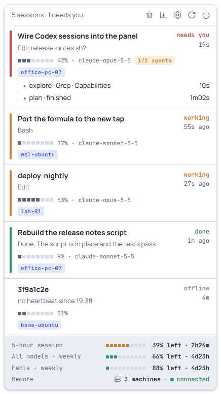
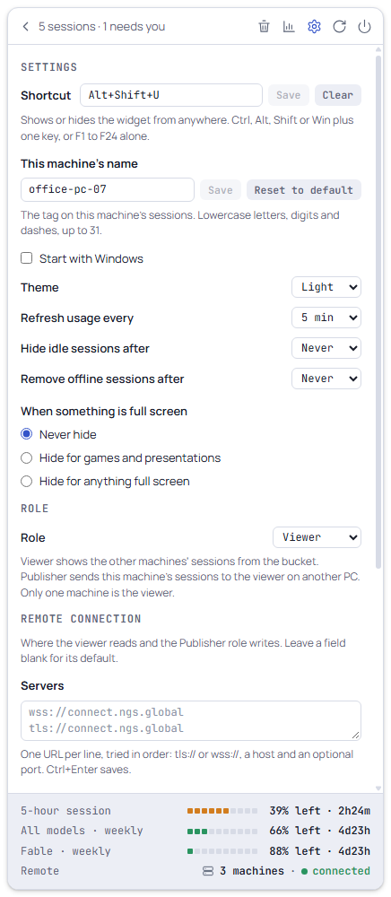
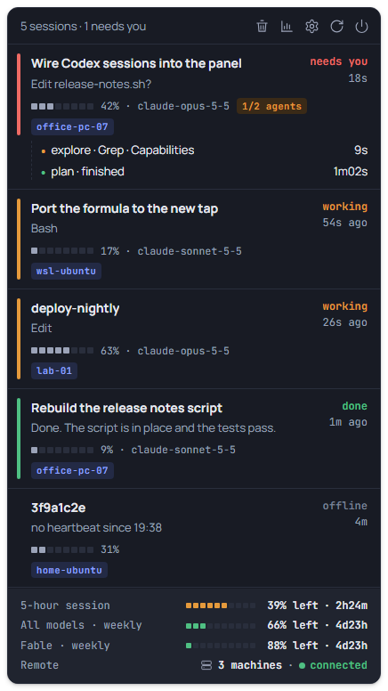

# Using the widget

The widget is a floating panel with three views (sessions, usage, settings)
and a footer with the plan usage that every view shares.



## Sessions

The main view lists every Claude Code session, local and remote, most urgent
first:

| State | Meaning | Time shown |
|---|---|---|
| needs you | waiting for a permission or an answer (hooks only) | how long it has waited |
| failed | the turn ended with an error (hooks only) | how long ago |
| working | busy | how long the turn has run |
| done | the turn finished (hooks only) | how long ago |
| idle | open, doing nothing | how long ago |
| offline | a remote session whose machine stopped sending heartbeats | how long it has been offline |

A remote row shows how long ago its machine last reported instead.

**Publisher keys to review.** A machine's sessions show only once its key
is accepted here. When values arrive sealed with a key this viewer has not
pinned, a compact notice above the list asks about it, one line per key:
"New machine `lab-01` wants to publish · key `p20261014-3f9a AbCdEfGh`" for a
machine never seen, or "`lab-01` presents a new key (`p20261014-3f9a
AbCdEfGh`)" for a known one (a replaced or rotated key, or a reinstall
after its data was purged; a plain reinstall keeps the key). After
the key id comes its fingerprint, the first 8 characters of the key; the
tooltip adds when it was first and last seen, how many values are held
back, and the whole key line. Compare it with what the machine printed
(Settings → Role on an app, `cc-publish keygen`, `make install`,
`update.sh`, `Install.ps1`, `rotate-key`). **Accept** pins it, and the machine's sessions
show from its next write (within a minute); **Reject** drops its values from
then on (counted in the Remote line's tooltip). Nothing is decided without
the click, and a key left waiting is still there after a restart. Past
three keys, the others are summed up under the rows. The tray tooltip says
`1 key to review` meanwhile.

Each row, top to bottom:

1. **Title**: the session's title from its transcript (Claude Code's
   generated title, or a custom one when set), and the state with its time on
   the right. A coloured bar on the left shows the state (red needs you and
   failed, amber working, green done); idle and offline rows show the colour
   set with `/color`, if any.
2. **What it is doing**: the question while it needs you, `<tool> · <summary>`
   while working (for shell tools the summary is the tool's description or
   the program name, never the command line), the last message when done,
   the error when failed, `no heartbeat since HH:MM` when offline.
3. **Context meter**: eight cells, the percentage of the context window used,
   and the model. Exact when the status line chain reports it, estimated from
   the transcript otherwise; when the model's window is unknown, the token
   count instead, with the cells left empty. After the model, an amber
   agents tag when the session has subagents: `5 agents`, `2/5 agents` once
   some finished, green `5/5 agents` when all did.
4. **Machine tag**: on its own line, a blue tag with this machine's name
   (local rows) or the publisher's alias (remote rows). Long names are cut
   with an ellipsis; the tooltip has the whole name.

Subagents follow as up to four indented lines, running ones first, then
`+N more`. Each says what the subagent works on: `<type> · <task> · <tool>
· <summary>` with a running time, e.g. `Explore · Find the row code · Grep
· agentsBlock`, where the task is the description the main agent gave its
`Agent` call and the tool and summary are what the subagent runs now
(summarized like the row's second line). A finished one reads `<type> ·
<task> · finished` with how long it ran. Parts that are not known are left
out (`subagent` when nothing is); a long line is cut with an ellipsis, and
its tooltip has all of it.

Remote rows read the same way: the publisher sends the session's title (up
to 80 characters), its folder name (up to 64, never the path) and the text
the second line shows in its state (up to 120), plus the tool name and
model (each up to 64 on the viewer) and context percentage, and how many
subagents run of how many, so the `2/5 agents` tag shows. The first six
subagents (running ones first) also travel as a line each: type (up to
24 characters), task (60), tool (32) and summary (60). A whole session
value is held to 2800 bytes of JSON, and the lines get what the other
fields leave: six full lines travel with texts in ASCII or CJK at their
caps, fewer only when long texts are in four-byte characters such as
emoji. Subagents without a line show as
`subagent` (running) or `subagent · finished`, and remote subagent times
count from the session's last state change. A
session whose own turn ended while background agents still run shows as
`working`, with "N agents running" on the second line, here and remotely.
A remote row without a title shows its folder name as its title, and one
with neither the session's hashed id (8 hex characters).

Without hooks a session only reports busy or idle, and its row says
`No detail yet: restart the session`. A hooked session with no hook event
for over 10 minutes is marked as possibly stuck in its tooltip.

Clicking a local row brings its window to the front. The tooltip says where
the click lands: the exact console window, or only the application (VS Code
and Windows Terminal cannot select a tab from outside). Remote rows cannot be
focused. While the pointer is over the list, it does not reorder, so a row
never jumps away from a click.

The header reads `5 sessions · 1 needs you`, plus `· N hidden` when the idle
filter hides rows.

## Header buttons

| Button | Action |
|---|---|
| Wastebasket | clears the session list (see [Clearing the list](#clearing-the-list)) |
| Chart | opens the usage view; click again to go back to the sessions |
| Gear | opens the settings view; click again to go back to the sessions |
| Refresh | reads the plan usage now |
| Power | hides the widget; quit from the tray menu |

## Usage view

**Account**: the signed-in email and plan, and a globe button that opens
`https://claude.ai/settings/usage` in the browser.

**One chart at a time.** The section title is the switch:
`ACTIVITY · USAGE HISTORY`; click a word to show that chart. Activity is the
default.

- **Activity**: a calendar of six months, one cell per day in GitHub's
  greens, the shade a day's share of the busiest day shown. Hovering a cell
  shows that day's tokens and its busiest hour. Every machine is summed
  unless a machine filter is on (below). Claude Code keeps about 30 days of
  transcripts, so the widget saves each day as it sees it and the calendar
  fills in over the months. A saved day's count only grows: a lower count
  means transcripts were deleted, not that fewer tokens were used.
- **Usage history**: every plan limit over time, including the per-model
  ones, on a time axis with round local times. Ranges `1h`, `6h` (default),
  `1d`, `7d`, `30d`. A line is cut where its window reset and where nothing
  was recorded (the widget was not running), and ends with its current
  value. At most one sample is stored per 5 minutes, whatever the refresh
  interval.

**Context window**: the current session's context use from the status line,
shown only while that data is fresh.

**Usage by project**: the last 30 days, every project on every machine, each
with its machine tag, sessions, tokens and estimated cost. With more than one
machine, clicking a tag shows only that machine's projects (and filters the
Activity calendar too); a chip with the machine's name next to "Last 30 days"
clears the filter, as does a second click on the tag. Other machines'
projects come from their publishers and are kept after a machine goes
offline, until their last activity is older than 30 days.

Costs are estimates at API list prices built into the app (the date is shown
under the list); a subscription is not billed per token. A model without a
price shows `n/a`, never `$0`, and a notice under the list names the
models, the file to add their prices to and an example. To add or override
prices, put a `pricing.json` in the data folder (`%LOCALAPPDATA%\cc-usage`,
or `CC_USAGE_DATA_DIR`): one entry per model, with `input` and `output` and
optionally `cache_write` and `cache_read` (the input price when left out), in
US dollars per million tokens, for example
`{"claude-opus-5": {"input": 5, "output": 25, "cache_write": 6.25, "cache_read": 0.5}}`.
An entry replaces the built-in price of that model; a dated model id such as
`claude-haiku-4-5-20251001` also matches an entry named `claude-haiku-4-5`.

## Settings view



The panel has a light and a dark palette (the design document's two), chosen
by **Theme**. With System it follows Windows' "app mode" as it changes;
charts redraw in the new colours.



| Setting | Choices | Default |
|---|---|---|
| Shortcut | click the field, press the combination (Ctrl, Alt, Shift or Win plus one key, or F1 to F24 alone), Save; Clear for none | `Alt+Shift+U` |
| This machine's name | the tag on local rows: lowercase letters, digits and dashes, up to 31; "Reset to default" | the computer name reduced to those rules (`OFFICE-PC-07` shows as `office-pc-07`) |
| Start with Windows | checkbox, same as the tray item | off |
| Theme | System (follows the Windows app theme, live), Light, Dark | System |
| Refresh usage every | 2, 5, 10, 15 or 30 min; applies at once | 5 min |
| Hide idle sessions after | Never, 15 min, 30 min, 1 h, 4 h | Never |
| Remove offline sessions after | Never, 5, 10, 30 or 60 min after the last heartbeat | Never |
| When something is full screen | Never hide; Hide for games and presentations (Direct3D full screen, presentation mode); Hide for anything full screen (also a remote desktop client or a maximised browser) | Never hide |
| Role | Viewer, Publisher (see [Role](#role)); switching restarts the app | Viewer |
| Remote connection: Servers | NATS server URLs, one per line, tried in order (`tls://` or `wss://`, a host, an optional port); blank for the default; Save (or Ctrl+Enter), Reset to defaults | `wss://connect.ngs.global`, `tls://connect.ngs.global` |
| Remote connection: Bucket | the KV bucket, 1 to 64 letters, digits, `-` or `_`; blank for the default | `cc-sessions` |

A shortcut that Windows or another application already holds is not saved,
and the reason is shown under the field. An invalid machine name is not
saved either; the note suggests the nearest valid one.

**Remote connection** sets where the viewer reads and the Publisher role
writes (details in [Connection settings](remote.md#connection-settings)).
The servers and the bucket are checked with the rules the connection
applies: a value it would refuse (a plaintext `nats://` URL, a user or
password in a URL, a bucket with a dot) is not saved, and the reason shows
under the group in red while the typed text stays to be corrected. A blank
field is the default, shown greyed in the field; **Reset to defaults**
blanks both. The viewer reconnects with the new values at once; in the
Publisher role they apply after a restart (**Restart cc-usage** appears
under the group). When `CC_USAGE_NATS_SERVERS` or `CC_USAGE_NATS_BUCKET` is
set, it wins: that field shows the value in force, read-only, with a line
naming the variable. A saved value that cannot be used (from a hand edit) is
listed in red under the group, as in the footer's Remote tooltip.

The top of the view lists, in red, a folder override the app ignores: a
`CC_USAGE_DATA_DIR` or `CLAUDE_CONFIG_DIR` set to a relative path
(`CC_USAGE_DATA_DIR is relative (data) and is ignored; set an absolute
path. Using …`), with the folder used instead.

Settings are stored in `%APPDATA%\ar.cc.usage\settings.json` (see
[data-and-privacy.md](data-and-privacy.md)). A hand-edited value that does
not parse resets only that setting to its default; a delay that is not one of
the choices snaps to the nearest one. The last line of the view is the app's
version (`cc-usage <version>`), as in the tray menu.

The Remote connection group is the file's `"nats"` object; the other
settings' saves keep it as it is.

**Start with Windows** writes one value, `cc-usage`, under
`HKCU\Software\Microsoft\Windows\CurrentVersion\Run`: the exe path in quotes.
Enabling it also re-enables the entry in Task Manager's Startup list if it
was disabled there. Uninstalling the app (not an
update) removes the value and its Task Manager entry.

### Role

Exactly one machine is the **viewer**: it reads the NATS bucket
(`cc-sessions` unless [the settings](remote.md#connection-settings) name
another) and shows the other machines' sessions, projects and activity. Every other
machine publishes. A machine without the app publishes with `cc-publish`; a
machine **with** the app must never run `cc-publish` too (both would drain
the hook spool), so the app publishes itself: **Role: Publisher**.

- **Viewer** (the default) reads the bucket. It ignores values under its
  own name (this machine's name), so a PC that has published under that
  name does not show its own sessions twice.
- **Publisher** sends this machine's sessions, host record, projects and
  activity, exactly what `cc-publish` sends, under this machine's name as
  the alias. There is no viewer connection: the header and the session
  list show local rows only, and the usage view shows this machine only.

Choosing the other role asks first ("cc-usage restarts to switch role");
**Switch and restart** saves it and restarts the app in the new role.

In the Publisher role the block lists what publishing needs, each with ✓ or
✗ and its file:

- **Credentials**: `%LOCALAPPDATA%\cc-usage\nats\cc-sessions.pub-<name>.creds`,
  present and for that NATS user. **Import creds…** opens a `.creds` file,
  checks the user inside matches `cc-sessions.pub-<name>` (the error names
  the user found, never the secrets) and copies it there privately.
- **Publisher key**: `keys\publisher.key`. **Generate key** creates it when
  it is missing, in one click, and shows its public key line with a
  **Copy** button: the line the viewer's flyout offers to accept the first
  time this machine publishes (compare its key id and fingerprint, the
  first 8 characters after the colon). Once the key exists the button reads
  **Replace key…**: the key is the machine's identity, so it asks first,
  warns that the viewer holds back this machine's values until the new key
  is accepted there, and replaces it only after this machine's name is
  typed in the box (**Replace key**; **Cancel** or Esc keeps it).
- **Viewer public key**: `keys\viewer.pub`. **Import viewer key…** opens the
  viewer's `viewer.pub`, checks its format (and that it is not this
  machine's own key) and installs it.

The app seals every value with its own key pair to the viewer's public key: without both key files it does not publish.
Once the three checks pass it starts
publishing on its own within 30 seconds (at once after an import). While it
publishes, a new import needs no restart either: the running publisher uses
it at once and the note says so ("Applied: now sealing with publisher key …
to viewer key …", "Accepted: trying the new credentials; they replace the
connection once it is up"); a file
it cannot use leaves it on what it had, and the note, in red, says why.
New credentials are tried on a second connection first and replace the
current one only once it is up: credentials that are stale, expired or
revoked leave it connected, and the footer's tooltip says "Credentials not
applied: …" until a file that works replaces them.
Files replaced by hand are picked up within 30 seconds. A new
machine name applies after a restart (**Restart cc-usage** appears). How to
prepare a PC and how to move the viewer: [remote.md](remote.md#a-pc-with-the-app-as-a-publisher).

### Data

The usage history, the Activity calendar's days and the other machines'
projects live only on this machine: the NATS bucket forgets a value after 3
minutes. The **Data** block at the end of the settings view keeps them in
one `.ccbak` file.

- **Back up…** asks where to save (Documents by default,
  `cc-usage-backup-<machine>-<YYYYMMDD-HHMM>.ccbak`) and writes the data
  files. With **Include keys and credentials** checked it also seals the
  viewer's key pair, the pinned and rejected publisher keys (not the ones
  waiting for review) and the NATS creds with a
  password (8 characters or more,
  typed twice), which is what moving the viewer to another PC needs
  ([remote.md](remote.md#moving-the-viewer-to-another-pc)). A data file
  that cannot be read is left out and named in the note.
- **Restore…** opens a backup and shows what it holds (machine, date,
  samples, days, projects, keys yes or no) without changing anything.
  **Restore** then adds it to what is here; **Cancel** drops it. A backup
  with keys asks for its password; left blank, only the data is restored.
  A wrong password changes nothing.

A restore never replaces: samples this machine lacks are added, a day's
count only grows, a newer project value wins, `pricing.json` is written
only if there is none, and a key or credential is written only where it is
missing (the viewer key, the pin files and the rejected-keys files get the
keys they lack after their own). A credential that differs from the backup's is kept and named
in the note. Days a backup
made on another machine counted for itself show under that machine's name.
Settings, window position and notification state are not part of a
backup. What a backup holds:
[data-and-privacy.md](data-and-privacy.md#backups).

## Footer

One line per plan limit, with a ten-cell meter of what is used, what is
left and the time to the reset:

```
5-hour session          ■■■■■■□□□□ 39% left · 2h24m
All models · weekly     ■■■□□□□□□□ 66% left · 4d23h
Fable · weekly          ■□□□□□□□□□ 88% left · 4d23h
Remote                  [server] 3 machines · ● connected
```

The meter is green under 50% used, amber from 50% and red from 80%; when the
server marks a limit as a warning or critical, the meter takes at least that
colour. The percentage turns amber at a warning and red at critical (the
server's flag, or 80% and 95% used). The percentage and the countdown have
fixed widths, so the meters stay in one column. The tooltip spells the line
out: percentage used, time to the reset, and whether it is the limit that
applies now.

Per-model weekly lines (`<model> · weekly`) appear when the plan has them;
extra usage credits show as a `Credits` line. When a refresh fails, the last
good values stay, dimmed and with grey meters, under
`Stale data · updated <time>`. An expired token reads `The token expired.
Claude Code renews it on its next request; the data comes back on its own.`;
meanwhile the widget asks Claude Code to renew it by running `claude -p`
with no prompt in the background (at once, then at most every 5 minutes):
Claude Code renews its token when it starts and then stops with "Input must
be provided…", so nothing is sent; its start and end hooks are not recorded
(`CC_USAGE_NO_SPOOL` in its environment), so it never shows as a session. The widget never
renews the token itself, which could sign Claude Code out. It re-reads the
credentials file every 20 s (without calling the API) and refreshes as soon
as the token is renewed; the message's tooltip says when Claude Code was
last asked, or why it could not be (for example `claude` not found). That
file is
`.credentials.json` in `CLAUDE_CONFIG_DIR` when it is set, else in
`~/.claude`.

The **Remote** line shows the NATS feed: a server icon, the number of
machines and a coloured state: `● connected` in green, `● connecting…` in
amber, `● disconnected · retrying` in red, or muted `not configured` when the
viewer credentials are missing (see [remote.md](remote.md)). Its tooltip has
the detail: `Watching <bucket> over <server>`, last error, a NATS setting
that was ignored and why (it falls back to the default, see
[Connection settings](remote.md#connection-settings)), values that could not be opened (a wrong
key, tampering, or an unsupported envelope version), keys
waiting for review (`1 key to review`), values dropped because their key
was rejected (`lab-01: 3 value(s) from a rejected key dropped`), and machines
whose pin file holds no usable key (`lab-01: unknown sender key — values
rejected`).

A folder override the app ignores (a relative `CC_USAGE_DATA_DIR` or
`CLAUDE_CONFIG_DIR`) adds a line to the footer's tooltip and to the Remote
line's, in both roles, and a warning to `cc-usage.log`; the settings view
lists it too.

In the Publisher role the line is about publishing instead, with the same
colours: `publishing as <name> · ● connected` (green), `● connecting…`
(amber), `● disconnected · retrying` (red, the last error in the tooltip),
or muted `not configured`, with what is missing in the tooltip (the creds,
the publisher key, the viewer key, or a `cc-publish` already running on
this machine). Connected, the tooltip reads `Publishing <bucket> as <user>
over <server>` and says how many sessions and projects go out; it also
names a NATS setting that was ignored. The tray tooltip's first line adds
`publishing as <name>`.

## Tray icon and menu

One icon, the app's activity grid, with a red badge while a session needs
you. Left click shows or hides the widget, right click opens the menu. The
tooltip leads with the session count and how many need you (and
`1 key to review` while a publisher key waits in the flyout's notice), then
each limit's percentage used.

| Menu item | Action |
|---|---|
| cc-usage <version> | greyed out, the installed version (also at the bottom of Settings) |
| Show/Hide | toggles the widget |
| Reset position and size | back to the default size at the top right of the primary monitor |
| Refresh now | reads the plan usage now |
| Clear sessions | same as the wastebasket |
| Open claude.ai/settings/usage | opens the usage page |
| Start with Windows | checkable, shows the real state |
| Quit | exits the app |

## The floating window

Always on top, no frame, no taskbar button, shown at startup. Starting
cc-usage again (from the Start menu, say) while it runs shows the widget
of the copy already running; a second copy does not start.

- **Move**: drag the header or any empty part of the panel. It moves across
  monitors, including ones with different scaling.
- **Hide**: double-click the header or an empty part of the panel, click the
  power button, press Escape in the session list, or use the shortcut. A
  double-click on a row, button, field or edge keeps its own meaning.
- **Back**: in the usage and settings views, the `‹` button left of the
  header summary (or Escape, or the view's own header icon again) returns to
  the session list.
- **Resize**: drag any edge or corner. Double-click an edge to go back to the
  default size. Until you resize it, the height follows the content; after
  that your size is kept and the list scrolls.
- **Remembered**: position and size are saved to `window.json` (next to
  `settings.json`) and restored
  on start. A position on a monitor that is no longer connected falls back to
  the top right of the primary monitor.

## Notifications

Toasts (installed app only):

- **A session needs you**: `<session> needs you` with the question, or
  `<session> on <machine> needs you` for another machine's session.
  Sessions already waiting when the widget starts (or, for remote ones,
  when the viewer connects or reconnects) do not toast, and a session that
  comes back after a clear does not toast again.
- **Plan limits**: a warning when a limit reaches 80% and a critical alert
  at 95% (or when the API flags the limit as such), each once per reset
  window: `5-hour session at 82%`, `Resets in 1h 12m`. What was already
  alerted is kept in `notification-state.json`, so a restart does not repeat
  it.

## Clearing the list

- **The wastebasket** (or tray, "Clear sessions") removes every row. A local
  session that is still alive comes back on the next pass (about 2 s) with
  its state and question intact and without a second toast; its tool and
  subagents return with its next hook event. A session that ended does not
  come back, unless it is waiting for you. A remote row stays dismissed until
  its key gets a newer write: a machine still publishing shows it again with
  its next heartbeat (60 s at most), a dead session stays gone.
- **Hide idle sessions after** hides local and remote rows idle for longer
  than the delay. It is a view filter: the row shows again as soon as its
  state changes, and the header counts it as hidden.
- **Remove offline sessions after** drops a remote row that long after its
  last heartbeat. With Never (the default) it stays, offline, until the
  wastebasket.
- A local session whose process ended leaves the list on its own.
